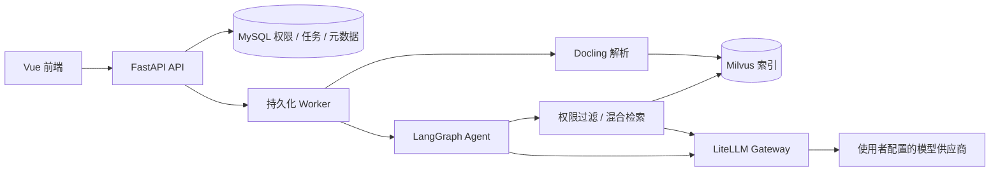

# RAG Studio

基于 FastAPI、Vue、LangGraph、MySQL、Milvus、LiteLLM 与 Docling 的知识库问答项目。
支持文档入库、权限过滤、混合检索、带引用回答、持久化任务与评测。

## 功能与边界

- 文档语义分块，保留标题、页码、来源位置和 Parent-Child 关系。
- Dense / BM25 混合检索、RRF、MMR、Reranker，以及租户、文档权限和当前版本过滤。
- 统一 Agent 调用知识检索和只读模拟工具；答案校验后展示，SSE 推送任务进度。
- 持久化 Job、租约、恢复与重试，来源撤权、题集评测和预算控制。
- 可选 Langfuse 观测，默认关闭。

四个业务诊断工具全部返回合成 fixture，不连接真实业务系统。项目不附带业务文档、用户记录、真实问答、供应商凭据或运行报告，也不声称已通过生产规模验收。

## 架构



## Quick Start（Windows / Linux / macOS）

推荐使用 **Python 3.10+ + Docker Engine / Docker Desktop + Compose v2**。所有平台均使用同一套命令；不需要 PowerShell、Node.js 或本机 Python 3.12 环境。容器会构建 Vue 前端和 FastAPI 后端，并启动 MySQL、Milvus、LiteLLM 和 Docling。首次启动需要下载镜像、安装依赖。

```sh
git clone https://github.com/songsinfo/rag-studio.git
cd rag-studio
python scripts/quickstart.py init
```

若你的系统使用 `python3` 命令，请将下面的 `python` 替换为 `python3`。Windows 也可以使用 `py -3`。

初始化会生成被 Git 忽略的 `.runtime/demo.env` 和随机演示凭据；重复运行不会覆盖既有配置。用本地文本编辑器打开该文件，至少填好供应商的 `MODEL_BASE_URL`、`MODEL_API_KEY`、`CHAT_MODEL`、`EMBEDDING_MODEL` 和 `JUDGE_MODEL`。有重排模型时再设置 `RERANK_MODEL`；确保 `EMBEDDING_DIMENSIONS` 与实际模型一致。模型通过 LiteLLM 适配，不保证任意供应商都实现相同的模型端点。

```sh
python scripts/quickstart.py config   # Validate the merged Compose configuration
python scripts/quickstart.py up       # Build and start all services
```

浏览器访问 **http://localhost:5173**；租户代码为 `demo`，用户名 `admin`，密码在本地 `.runtime/demo.env` 的 `RAG_SEED_PASSWORD` 中。Web 端口可由 `RAG_WEB_PORT` 自定义。端口仅绑定到 `127.0.0.1`，不是用于互联网直接暴露的生产部署。

```sh
python scripts/quickstart.py ps
python scripts/quickstart.py logs --service backend
python scripts/quickstart.py down     # Preserve database and index volumes
```

仅在确定无需保留本地 MySQL、Milvus 和对象存储数据时使用 `python scripts/quickstart.py down --volumes`。配置不受该命令影响。启动失败时请先执行 `logs --service backend`，并确认 Docker 内存配额、模型地址及 Docker Compose 可用。所有服务仍需网络访问镜像仓库和配置的模型供应商。

> **注意**：本流程是本地开发/演示环境。浏览器通过 Nginx 同源转发 `/api`；容器内使用服务 DNS 地址，而不是 `localhost`。真实文档会上传到所选模型供应商，切勿上传无权处理的资料。首次运行会使用随机管理员密码，且不会打印密钥。

### 原生开发方式（Windows / Linux / macOS）

Python 3.12+ 本地开发时，创建虚拟环境、安装后端依赖：

```sh
python -m venv backend/.venv
# Linux / macOS:
backend/.venv/bin/python -m pip install -r backend/requirements.txt
# Windows:
# backend/.venv/Scripts/python.exe -m pip install -r backend/requirements.txt

python scripts/dev.py init --environment demo
# 填写 .runtime/demo.env 的模型配置
python scripts/dev.py deps --environment demo --documents
python scripts/dev.py backend --environment demo --port 8080
```

另开终端执行 `cd frontend && npm ci && npm run dev`。若已通过 `quickstart.py up` 启动完整应用，请先关闭该环境，避免两个后端共享端口和数据。

## 测试和评测

默认离线测试不连接真实供应商：

```sh
cd backend
python -m pytest tests regressions -q -p no:cacheprovider
cd ..
python -m unittest discover -s tests -p 'test_python_tooling.py' -v
```

前端在 `frontend` 目录执行 `npm run check`、`npm test`、`npm run build`。

下列测试均**显式执行**，需先启动对应的本地服务；其中真实模型和消融实验可能产生费用。不要在共享生产环境运行会创建文档、知识库和评测数据的验收脚本：

```sh
python scripts/acceptance.py backend --environment demo
python scripts/integration.py --environment demo
python scripts/acceptance.py gateway --environment demo
python scripts/evaluation.py validate datasets/YOUR_DATASET.jsonl
python scripts/evaluation.py bind datasets/YOUR_DATASET.jsonl
python scripts/evaluation.py ablation --self-test
# 有真实数据与合成/脱敏审批，且确认成本上限后：
# python scripts/evaluation.py ablation --dataset-path .runtime/eval-bound.jsonl --approved-synthetic-or-redacted --max-cost-cny 1
# python scripts/acceptance.py real model --max-cost-cny 0.5
# python scripts/acceptance.py real assertions --max-cost-cny 0.5
```

Langfuse 私有合成验收环境：

```sh
python scripts/langfuse_local.py init
python scripts/langfuse_local.py up
python scripts/langfuse_local.py check
# 故障恢复测试（会暂时停止本地 Langfuse web/worker）：
# python scripts/langfuse_local.py check --outage
python scripts/langfuse_local.py down
```

所有私有凭据和验收导出仍保存在被忽略的 `.runtime/`、`.local/` 中。

## 示例与隐私

`datasets/` 只提供合成测试样例。EOBS 候选标签由代码编写，未宣称人工确认；真实模型校准前需自行审核标注。
`artifacts/baseline-report.json` 是新编写的合成格式示例，数字不是实测结果，也不能用于宣称性能收益。

使用在线模型会把选定内容发送给配置的供应商；只上传自己有权处理的资料。
Langfuse 正文观测需单独启用，启用前应确认接收方和访问权限。
本地凭据、上传件、索引、备份、日志和评测导出应持续保存在被忽略的目录。

## 目录

| 目录 | 内容 |
| --- | --- |
| `backend/app` | API、权限、入库、检索、Agent、评测、Worker |
| `backend/tests` | 单元与集成测试 |
| `backend/regressions` | 离线安全、生命周期与并发回归测试 |
| `frontend` | Vue 控制台 |
| `deploy` | 本地依赖与可选 Langfuse Compose |
| `docs/design` | 数据库 schema、迁移和索引映射 |
| `scripts` | 环境初始化、启动和验证脚本 |

## License

[MIT](LICENSE)
