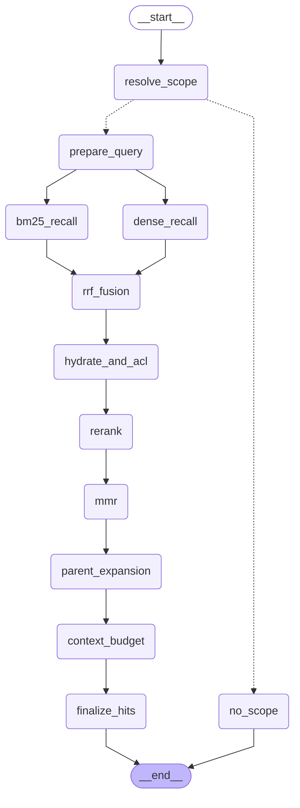

# 检索工具图

统一 Agent 使用 `RagRetrievalGraph` 执行权限过滤、查询扩展、多路召回、融合、重排与证据回填。
图定义在 `backend/app/retrieval/rag_graph.py`。
在 backend 目录执行 `python scripts/export_rag_retrieval_graph.py --write` 更新以下图示。

<!-- compiled-rag-retrieval-graph:begin -->

<!-- compiled-rag-retrieval-graph:end -->
